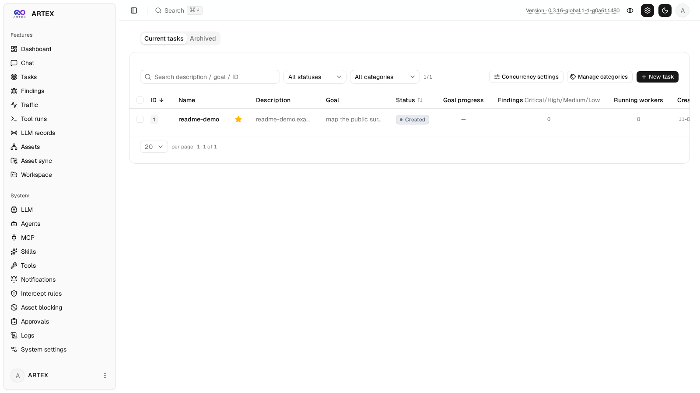
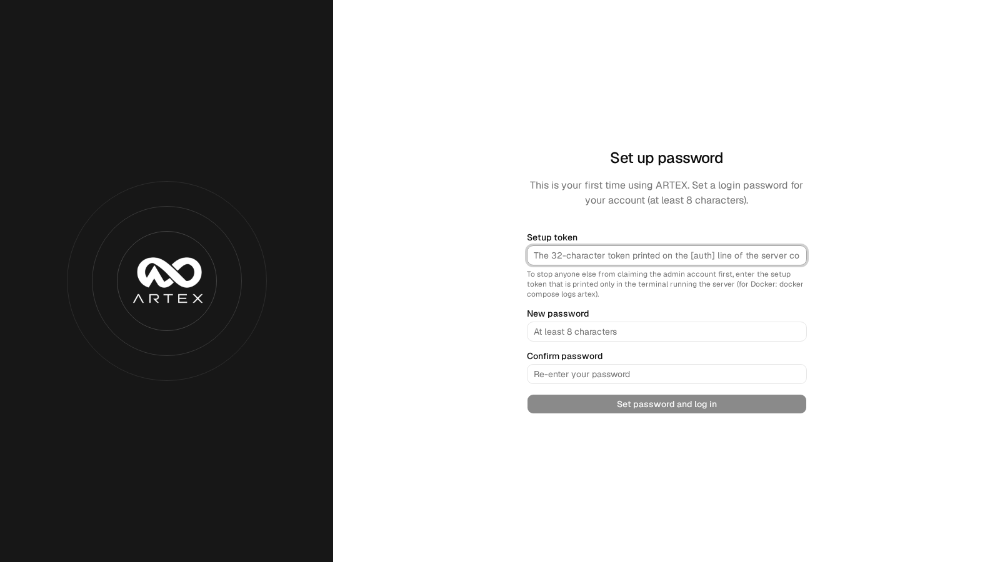

<div align="center">

# ARTEX ACP Edition

**An autonomous penetration-testing console driven by LLM multi-agents.**
Go backend + Next.js frontend, built from source as a single container image.

[](LICENSE)

</div>

---

> ## Security & misuse warning — read this first
>
> **ARTEX autonomously plans and executes real attack chains. Run it only against
> infrastructure you own or are explicitly authorized to test, and only to build
> defensive and detection capabilities.**



## What ARTEX ACP Edition is

An operator-facing platform for authorized penetration testing. You describe the
goal; a planner decomposes it, worker agents execute testing intents across the
engagement surface, findings flow through verification and independent
re-check, and every claim lands in an evidence-backed report. The UI, agent
output and reports are in **English and Russian** (switchable in Settings);
English is the built-in literal, Russian ships as a catalog.

Key capabilities:

- **Autonomous multi-agent engine** — planner/worker orchestration over a live
  exploration graph (facts, intents, findings, assets), with goals proved
  explicitly before a task can close.
- **Finding quality pipeline** — filing a finding requires a verification
  (exact source reference or clean-session reproduction); an independent
  read-only verifier agent then re-checks recorded findings by severity policy
  and drives a `verified/refuted` state.
- **LLM reliability layer** — one failure classification (retry / switch /
  fail / quality) shared by the provider pool, quota detection and retries;
  text semantics beat status codes.
- **Evidence-grade traffic capture** — an MITM recording proxy captures worker
  HTTP/S traffic; findings bind to the exact request/response pairs that prove
  them.
- **MCP ingress** — ARTEX itself serves MCP (`POST /mcp`, Bearer token), so
  external harnesses can hand in tasks and poll status.
- **Demo mode** — one click masks sensitive fields for video recording and
  presales screen shares.
- **Credential hygiene** — optional AES-256-GCM encryption of stored keys at
  rest; scoped, single-use task credentials are revoked by procedure after
  each run.
- **Provenance & reporting** — per-task artifact inventory with audited
  cleanup, report versions with chat-driven revisions, retests, CVSS-calibrated
  severity.

## Quick start

Prerequisites: Docker with buildx. Build takes a few minutes (frontend + Go
binary + toolset, all from source):

```sh
git clone https://github.com/gh-agent3/artex-global.git artex
cd artex
./build-image.sh .
```

Run the minimal stack (PostgreSQL pinned by digest, ARTEX pinned by its
binary-hash tag):

```sh
ARTEX_IMAGE=artex-local:<short-sha>-<hash> docker compose up -d
```

Open `http://127.0.0.1:8787` — first start prints a one-time setup token in
the logs (`docker logs artex-artex-1`); use it to set the admin password.



### Single-user / local mode (experimental)

Skip PostgreSQL and run on SQLite (pure Go, no CGO):

```sh
ARTEX_PG_DSN="file:/path/to/artex.db?_pragma=journal_mode(WAL)&_pragma=busy_timeout(5000)" ./artex
```

Core flows are validated on SQLite (`db/sqlite_core_test.go`); the default and
fully supported backend remains PostgreSQL.

## Operating modes

- **Server deployment** (default) — the container behind your reverse proxy or
  VPN; the operator console for a team or a single operator.
- **Local / desktop-friendly** — the same single binary with the UI embedded,
  on SQLite, on a laptop. No separate installer is required.

## Integrations

- **MCP (Model Context Protocol)** — set `ARTEX_MCP_TOKEN` to expose
  `task_create` / `task_status` / `task_list` to external harnesses
  (e.g. paperclip). Without the token the endpoint is not mounted at all.
- **LLM providers** — any Anthropic-compatible, OpenAI-compatible or Gemini
  endpoint; per-profile chains with circuit-breaker failover, per-endpoint
  retry ladders and provider quota detection.
- **MCP tool servers** — attach external tool servers (browser, GitHub and
  friends) to agents through the built-in registry.

## Security posture

- Fail-closed by default: no setup token → no admin account; no MCP token → no
  MCP surface; encryption off unless explicitly enabled.
- Version string in the UI header links to the exact commit; hover shows the
  commit subject and date.
- Dependency and secret scanning run in CI (govulncheck, npm audit, trivy,
  gitleaks, trufflehog) across the full history.

## Documentation

- `docs/demo-mode.md` — demo mode design and decisions
- `docs/fork-review.md` — the standing process for reviewing third-party forks
- `docs/forks/` — per-fork reviews (ARTEX-HYDRA and successors)
- `docs/backlog.md` — known gaps, SQLite coverage notes, pending improvements
- `docs/adr/` — architecture decision records

## Branches and releases

- `main` — release branch; releases are tagged `v<version>`
  (current: `v0.3.16-global.1`)
- `dev` — active development

## License

AGPL-3.0. Derived from the ARTEX project (upstream: Autumn-27/ARTEX and the
global edition lineage); see `LICENSE` and `skills/NOTICE.md` for third-party
attribution.
