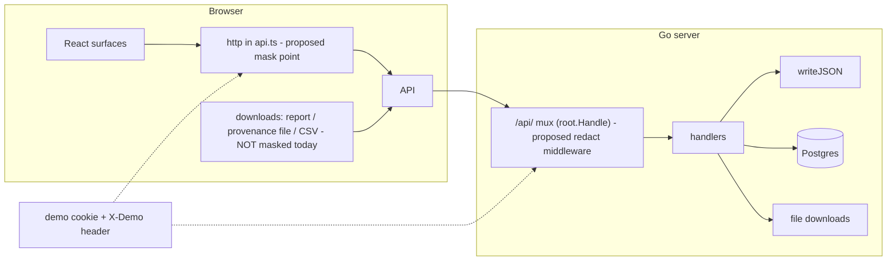

# Demo mode (eye) - architecture review

## Provenance

    Skill:        arch-review (bundled OpenCode skill)
    Reviewed at:  2026-11-02T18:36:22Z
    Target:       /tmp/build/artex-fork, remote: https://github.com/gh-agent3/artex-global
    Commit:       f8a0fcdddbd82d4f5ec144306be4e5feeaa3cdaf  (ru-locale)
    Tree state:   clean - 0 uncommitted files
    Files in scope: 8 of 822 (docs/demo-mode.md, server/demo_settings.go,
                  web/src/app/(main)/system/settings/_components/demo-card.tsx,
                  web/src/components/demo-{markdown,mode,toggle}.tsx,
                  web/src/lib/demo.ts, plus the per-surface wiring in
                  web/src/app/(main)/function/tasks/{page,detail/{page,_tabs/{graph-tab,report-tab}}}.tsx
                  and web/src/app/(main)/system/llm/page.tsx)
    References applied: references/design-doc.md (grading docs/demo-mode.md),
                  references/trust-boundary.md (the /api/ entry point)
    Entry-point coverage: verified, 1 enumerated - root.Handle("/api/", api) at server/server.go:1076;
                  single JSON writer writeJSON at server/server.go:4136;
                  single client transport http<T>() at web/src/lib/api.ts
    Not examined: the Go task engine, agent prompts, llmpool, notification delivery - demo
                  mode does not change them; web/messages locales beyond key parity
    Method:       static read-only review; nothing was executed, installed or fetched
    Reproduce:    re-run this skill against /tmp/build/artex-fork at the commit above

## Executive summary

- The per-surface masking approach is correct for instant toggle + click-to-reveal, but it
  is unbounded work and has already leaked once (exploration graph) - the completeness of a
  demo mask cannot depend on remembering every render site.
- Downloads and exports (report version, provenance file, findings CSV) bypass masking
  completely; one click in a demo leaks everything the eye hides. This is the top gap.
- Industry pattern (Sentry, Datadog) is a two-lane model: a client-side MASK lane (value in
  memory, eye to reveal - exactly Datadog's Mask action) and a server-side REDACT lane for
  strict mode. ARTEX needs both, with one shared rule source.
- The client already has a single choke point (`http<T>()` in api.ts); the server has one
  (`/api/` mux + `writeJSON`). Moving masking there removes the per-surface problem entirely.
- Recommendation: field-name denylist (Sentry-style) + regex rules applied at the client
  transport; `<Sensitive>` kept only where reveal-on-click is required; a server redaction
  middleware behind an `X-Demo` header for demos with devtools open; downloads masked at the
  blob level and CSV export blocked while the eye is on.

## Scope

Reviewed: the demo-mode design (docs/demo-mode.md) and its phase-1 implementation:
state (cookie + `data-demo` boot attribute), masking components (`<Sensitive>`, `<DemoText>`,
`<DemoMarkdown>`), settings (`/api/settings/demo`, class list + regex rules), and the six
wired surfaces (LLM key hints, task name list/detail, exploration graph payload, report body).

Not reviewed: backend internals unrelated to data leaving the API (task engine, agents,
llmpool), and locale files beyond key parity. Deployment stage: existing system under change
(feature shipped in phase 1, hardening pending).

## How others do it (research findings)

Sentry (docs.sentry.io/security-legal-pii/scrubbing/):
- Server-side scrubbing on EVERY event: a default denylist of sensitive key names
  (password, token, bearer, privatekey, ...), plus "Additional Sensitive Fields" - a field
  name whose rule ALSO removes any VALUE containing that string (protects against secrets
  embedded in stringified JSON), plus "Safe Fields" exemptions.
- Advanced scrubbing: regex rules with path selectors ([Remove] [Anything] from [$user.geo.**]).
- SDK hook (beforeSend) for the case "data must never leave our environment".
- Known limitation worth stealing: scrubbing never changes a JSON type (a number stays a
  number); when in doubt it replaces with null.

Datadog (docs.datadoghq.com/security/sensitive_data_scanner, logs/guide/manage-sensitive-logs-data-access):
- Four actions on a match: Redact (replace whole match, permanent), Partially redact,
  Hash, and Mask. The Mask action is exactly our eye: the value is obfuscated in the UI but
  preserved; users with an unmask permission click an eye icon to reveal it.
- Critical rule for us: "Masked data that is accessed programmatically (API, Terraform,
  archives) always appears obfuscated and cannot be unmasked." Downloads are a boundary,
  not a view - they must be masked too.

Stripe / GitHub / Vercel pattern for true secrets: write-only fields, API returns only a
hint (last4 / "set"), the real value never leaves the server. ARTEX already does this for
LLM keys (api_key_hint); it is the right permanent treatment for `secret` class, and it
makes the demo problem for secrets smaller than it looks.

Consensus: mask at the boundary of what you protect. Protect the screen -> client mask.
Protect exports/API -> boundary redact. Protect against the viewer having devtools ->
server redact. ARTEX's threat model is "screen recording and screenshots", so the client
mask lane is the primary; exports are the hole; devtools are out of scope for phase 2.

## System view

## Findings

1. CRITICAL | Downloads and exports leak everything the eye hides.
   IMPACT: In a demo, one click on "Download" (report version, provenance artifact) or the
   findings CSV export writes the real data to disk; the eye becomes theatre.
   ROOT CAUSE: masking exists only in the render layer; the three download paths
   (taskReportDownload blob, taskProvenanceFile blob, findings CSV) fetch raw bytes.
   RECOMMENDATION: per Datadog's rule, masked data accessed programmatically stays obfuscated:
   apply `maskText` to the blob text for Markdown/report downloads, and refuse the findings
   CSV export while demo mode is on (a CSV is a data product, not a view). EFFORT: S.

2. HIGH | Per-surface masking cannot be complete.
   IMPACT: every new or missed surface leaks; the exploration graph already did
   (fixed by masking its payload, which proves the point: the fix was reactive).
   ROOT CAUSE: N render sites x manual wrapping; there is no single place that sees all data.
   RECOMMENDATION: move masking to the single client transport `http<T>()` in api.ts: walk
   the JSON, apply (a) a field-name denylist - Sentry-style default sensitive names
   (api_key*, token*, secret*, password, email, ...) plus operator additions, and
   (b) the existing regex rules to every string value. Keep `<Sensitive>` only for the few
   fields that need click-to-reveal (then exempt those field names from transport masking).
   Delete the per-surface DemoText/DemoMarkdown/graph masking. EFFORT: M.

3. HIGH | No server-side (strict) lane; values always leave the API.
   IMPACT: anyone with devtools sees everything; a demo over a shared screen with the
   network tab open is not safe.
   ROOT CAUSE: demo mode is a browser cookie; the API has no notion of it.
   RECOMMENDATION: client sends `X-Demo: 1` when the eye is on; a middleware at
   `root.Handle("/api/", ...)` applies the same rules to JSON responses (buffer with a size
   cap, skip SSE and file downloads). Guard the edit-form hazard: while demo is on, the
   client disables save/edit controls (simplest) or the middleware skips endpoints that
   feed forms. EFFORT: M.

4. MEDIUM | Regex rules only cover free text; typed values in arbitrary fields are not.
   IMPACT: an e-mail or hostname sitting in a field no rule names stays visible.
   ROOT CAUSE: rules are text patterns; there is no field-name classification.
   RECOMMENDATION: one field-name denylist shared between Go and TS (Go is the source of
   truth, served through /api/settings/demo); the client transport masks by name, the
   server middleware uses the same list. EFFORT: S (mostly deciding the list).

5. MEDIUM | Rule list lives in DB as operator-typed regexes; a bad pattern silently matches
   nothing (server validates on save, good) but also a greedy pattern can mask half the UI.
   IMPACT: a demo where everything is starred is almost as bad as a leak.
   ROOT CAUSE: no safe-mode defaults; no library rules.
   RECOMMENDATION: ship the Datadog-style starter library as suggested additions (email,
   IPv4, hostname, bearer token) rendered as chips the operator clicks to add, instead of
   free typing only. EFFORT: S.

6. LOW | Copy of a masked value copies the mask (good), but LLM key-hint Copy buttons and
   the report Copy button still expose values that ARE visible when revealed; acceptable.
   Also: task-name masking in the task list has no per-field reveal (link nesting) -
   documented trade-off. No action.

## Readiness by dimension

- Decision (where masking happens): GAPS - the two-lane model is decided in conversation
  but not encoded in docs/demo-mode.md as the target architecture; phase-1 code is
  single-lane per-surface.
- Trust boundary / API: GAPS - finding 1 (downloads), finding 3 (no server lane).
- Data model (classes + rules): GAPS - finding 4 (no field-name denylist), finding 5
  (no starter library).
- UX (eye, badge, shortcut, reveal): READY for phase 1.
- Testability: NOT ASSESSED in phase 1 - add a render test asserting no fixture secret
  appears in demo-mode output (see actions).

## Top five actions (impact over effort)

1. Mask downloads and block CSV export while the eye is on (finding 1) - S, closes the
   biggest hole.
2. Move masking to the client transport with a field-name denylist + rules; delete
   per-surface masking except `<Sensitive>` revealables (finding 2) - M, ends the
   whack-a-mole.
3. Add the `X-Demo` server redaction middleware with edit-lock while demo is on
   (finding 3) - M, enables demos with devtools open.
4. Publish the field-name denylist from Go and consume it in the client (finding 4) - S.
5. Add a fixture-secret render test and the starter rule library (findings 5, testability) - S.
