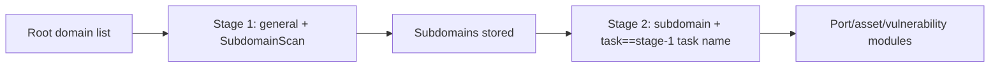

# ScopeSentry MCP usage guide

For users of an **already deployed ScopeSentry instance**. Connect to the platform through Cursor (or another MCP client); no local source code is needed.

## 1. Preparation

### 1.1 Confirm the service is reachable

- Default web UI: `http://<host>`
- MCP endpoint: `http://<host>/mcp` (if a reverse proxy or frontend proxy sits in front, use the actual `/mcp` address)

### 1.2 Create an API Key

1. Log in to the ScopeSentry web UI in a browser
2. Open the **API Key** management page and create a key (or create it through the interface the administrator provides)
3. Save the returned `ssk_...` string (**shown only once**)

### 1.3 Configure the Cursor MCP

Cursor → Settings → MCP → add a server:

```json
{
  "mcpServers": {
    "scopesentry": {
      "url": "http://<your-host>:8082/mcp",
      "headers": {
        "X-API-Key": "ssk_your-key"
      }
    }
  }
}
```

Alternatively use: `Authorization: Bearer ssk_your-key`

After configuring, restart the MCP server or reload Cursor and confirm that tools such as `list_projects` and `list_assets` appear in the tool list.

---

## 2. Tool overview


| Tool                   | Purpose                                           |
| ---------------------- | ------------------------------------------------- |
| `list_projects`        | project tree grouped by tag (including project IDs) |
| `list_projects_data`   | paginated project list, searchable by name         |
| `get_project`          | project details                                    |
| `create_project`       | create a project                                   |
| `list_tasks`           | scan task list                                     |
| `get_task`             | task details                                       |
| `list_scan_templates`  | scan template list                                 |
| `get_scan_template`    | template details                                   |
| `list_plugin_modules`  | scan pipeline module names                         |
| `list_plugins`         | available plugins (including hash, default parameters) |
| `create_scan_template` | create a scan template                             |
| `create_scan_task`     | create a scan task                                 |
| `list_assets`          | query assets of each type (paginated list)         |
| `count_assets`         | count assets (`/api/assets/common/total`)          |
| `get_asset_detail`     | asset or vulnerability details                     |
| `add_asset_tag`        | add a tag to an asset                              |
| `list_nodes`           | scan node list                                     |


Tool parameters follow the MCP tool description (schema); `list_assets` / `count_assets` share the same search and filter syntax, so read the `list_assets` description before querying assets.

When you need to know "how many records in total", use `count_assets` (it maps to the web pagination total endpoint); there is no need to page through `list_assets` repeatedly just to count.

---

## 3. Common workflows

### 3.1 Query assets by project

When the user or the context **already provides a project condition**, pass `filter.project` first to narrow the range, so that too much cross-project data does not slow the response down. If no project is clear, do not force a project filter.

1. Get the target project's **ObjectID** via `list_projects` or `list_projects_data` (`id` / `children[].value`)
2. Pass `filter.project` to `list_assets` (**it must be the ID, not the project's display name**)

```json
{
  "asset_type": "asset",
  "pageIndex": 1,
  "pageSize": 20,
  "search": "domain=^example.com",
  "filter": {
    "project": ["<project ObjectID>"]
  }
}
```

### 3.2 Create a scan task

1. Get online node names via `list_nodes`
2. Get the template **ObjectID** via `list_scan_templates` or `create_scan_template`
3. `create_scan_task`: `name` and `node` are required; `template` takes the template ID (not the template name)

**Target source `targetSource` (identical to the web UI):**

| targetSource | Description | Required parameters |
| --- | --- | --- |
| `general` | targets entered directly | `target` |
| `project` | read targets from a project | `project` (array of project ObjectIDs) |
| `asset` | search the web asset library | `search`; optional `project`, `filter`, `targetNumber` |
| `RootDomain` | search the root domain library | `search`; optional `project`, `filter`, `targetNumber` |
| `subdomain` | search the subdomain library | `search`; optional `project`, `filter`, `targetNumber` |
| `UrlScan` | search the URL scan results | `search`; optional `project`, `filter`, `targetNumber` |
| `*Source` (e.g. `subdomainSource`) | created from the asset page's "select/search" | use `search` when `targetTp=search`; use `targetIds` when `targetTp=select` |

**Example — scanning root domains directly:**

```json
{
  "name": "example-subdomain-collection",
  "node": ["node-1"],
  "template": "<template ObjectID>",
  "targetSource": "general",
  "target": "example.com\nfoo.com",
  "project": ["<project ObjectID>"]
}
```

**Example — continuing from the subdomain library (filtering by the previous task name):**

```json
{
  "name": "example-ports-and-vulns",
  "node": ["node-1"],
  "template": "<later module template ObjectID>",
  "targetSource": "subdomain",
  "search": "task==\"example-subdomain-collection\"",
  "project": ["<project ObjectID>"]
}
```

### 3.3 Full information gathering for root domains (two stages recommended)

When the input is a **root domain** and you want **full information gathering**, split it into two scans rather than running the whole pipeline at once.

**Reason:** distributed tasks are dispatched per **single target**. When a root domain is the target, the subdomains discovered on the node that received it keep running their later modules on that same node, which easily causes uneven load, slowness and errors.

**Best practice:**

1. **Stage 1 — subdomain collection only**
   - `targetSource`: `general`
   - `target`: all root domains (multiple lines)
   - Template: enable only `SubdomainScan`, `SubdomainSecurity` (subdomain scan + subdomain takeover)
   - Use `get_task` to wait for the task to finish

2. **Stage 2 — later modules**
   - `targetSource`: `subdomain`
   - `search`: `task=="<stage-1 task name>"` (exact match on the task name)
   - optional `project` to narrow the range
   - Template: port scanning, asset mapping, vulnerability scanning, etc. (SubdomainScan may be omitted)
   - Subdomains are dispatched to nodes as independent targets, which parallelises better

You can also filter by task name on the "Subdomain" asset page in the web UI and use "Create task from subdomains", which has the same effect.



### 3.4 Create a scan template

1. `list_plugin_modules` → module name list
2. `list_plugins` (filterable by `module`) → each plugin's `hash` and default `parameter`
3. `create_scan_template`: use `modules` to specify "module → array of plugin hashes"

---

## 4. Asset queries (`list_assets` / `count_assets`)

`count_assets` uses the same `asset_type`, `search` and `filter` as `list_assets`, returns `{ "total": N }`, and maps to the web endpoint `/api/assets/common/total`.

```json
{
  "asset_type": "subdomain",
  "search": "task==\"some-task-name\"",
  "filter": {"project": ["<project ObjectID>"]}
}
```

**Performance advice (applies to both `list_assets` / `count_assets`):** when a project condition exists, use `filter.project` first to narrow the range; in `search`, prefer `==` equality or `^` prefix matching (see [4.3](#43-search-expression)) on indexed fields, and avoid large-scale `=` fuzzy queries that slow the response down. With no project context, do not force a project filter.

Types that support `filter.project` are listed in the [4.4](#44-filter-exact-filtering) table.

### 4.1 Asset types `asset_type`

`asset`, `RootDomain`, `subdomain`, `app`, `mp`, `UrlScan`, `SensitiveResult`, `DirScanResult`, `crawler`, `vulnerability`, `PageMonitoring`, `IPAsset`, `SubdomainTakerResult`

Alias examples: `web`→asset, `vuln`→vulnerability, `ip`→IPAsset, `url`→UrlScan

### 4.2 Parameter notes


| Parameter                | Description                              |
| ------------------------ | ---------------------------------------- |
| `pageIndex` / `pageSize` | pagination, defaults 1 / 20              |
| `search`                 | search expression (see next section)     |
| `filter`                 | exact filter JSON (see next section)     |
| `sort`                   | sorting by `length` is supported for UrlScan and DirScanResult only |
| `sid`                    | SensitiveResult only: sensitive rule name |


`search` and `filter` **can be used together**.

### 4.3 search expression

A custom DSL (**not SQL**):


| Operator | Meaning                   | Index             | Example                          |
| ---- | ---- | ---- | --------------------------- |
| `=`  | fuzzy match (regex)       | does not use the index | `domain=example`            |
| `==` | exact match (equality)    | **uses the index** | `port==443`                 |
| `!=` | exclusion                 | — | `port!="80"`                |
| `&&` | AND                       | — | `domain==example.com && port==443` |
| `||` | OR                        | — | `title=admin || body=login` |


**Indexes and operators:** fields such as `domain`, `ip`, `port`, `title` are indexed, but only **`==` equality** or **prefix matching where the value starts with `^`** (e.g. `domain=^example.com`) can use the index; **`=` turns into a regex fuzzy match and cannot use the index**, so it tends to get slow on large datasets.

**search fields common to all types:** `tag`, `task` (task name), `rootDomain`

**project cannot be written inside search** (it is ignored, or errors when combined with `&&`). To filter by project, use `filter.project`.

**Common search fields per type:**


| asset_type           | Fields                                                                              |
| -------------------- | ----------------------------------------------------------------------------------- |
| asset                | domain, ip, port, service, app, title, statuscode, icon, banner, type, body, header |
| RootDomain           | domain, icp, company                                                                |
| subdomain            | domain, ip, type, value                                                             |
| app                  | name, icp, company, category, description, url, apk                                 |
| mp                   | name, icp, company, category, description, url                                      |
| UrlScan              | url, input, source, resultId, type                                                  |
| SensitiveResult      | url, sname, body, info, md5                                                         |
| DirScanResult        | url, statuscode, redirect, length                                                   |
| vulnerability        | url, vulname, matched, request, response, level                                     |
| crawler              | url, method, body, resultId                                                         |
| PageMonitoring       | url, hash, diff, response                                                           |
| IPAsset              | ip, domain, port, service, webServer, app                                           |
| SubdomainTakerResult | domain, value, type, response                                                       |


**search examples:**

- `domain==www.example.com && port==443` (equality, uses the index)
- `domain=^example.com` (prefix match, uses the index)
- `ip==192.168.1.1`
- `task=="some-task-name"`
- `level==high` (vulnerability)
- `statuscode==200` (DirScanResult)

Use `=` only when you need fuzzy containment, e.g. `title=admin` (it does not use the index, so pair it with conditions such as a project to narrow the range).

### 4.4 filter exact filtering

JSON object: multiple values under the same key are **OR**, different keys are **AND**.

**Prefer `project` when a project condition exists:** if the user or the context already makes the project clear and the asset_type supports `project`, pass it to narrow the range; with no project information, do not force it.


| filter key   | Meaning      | Value notes                                                |
| ------------ | -------- | -------------------------------------------------------- |
| `project`    | owning project | **ObjectID**, obtained via `list_projects` / `list_projects_data` |
| `task`       | source task  | **task name**, the `name` from `list_tasks`              |
| `port`       | port         | e.g. `"443"`                                             |
| `service`    | service/protocol | e.g. `"https"`                                       |
| `app`        | application fingerprint | e.g. `"Nginx"`                                |
| `icon`       | icon hash    |                                                          |
| `statuscode` | HTTP status code | mainly for asset                                     |
| `status`     | status       | UrlScan/DirScan HTTP code; processing status of vulnerabilities/sensitive findings |
| `level`      | vulnerability severity | critical / high / medium / low / info           |
| `type`       | type         | e.g. subdomain record type A, CNAME                      |
| `color`      | sensitive rule colour | SensitiveResult                                 |
| `sname`      | sensitive rule name | SensitiveResult                                    |
| `tags`       | tags         |                                                          |


**filter keys available per type:**


| asset_type                            | filter key                                                      |
| ------------------------------------- | --------------------------------------------------------------- |
| asset                                 | project, port, service, app, icon, statuscode, type, task, tags |
| RootDomain                            | project, tags                                                   |
| subdomain                             | project, type, task, tags                                       |
| app / mp                              | project, tags                                                   |
| UrlScan                               | status, tags                                                    |
| DirScanResult                         | status, tags                                                    |
| SensitiveResult                       | status, color, sname, tags                                      |
| crawler                               | project, task, tags                                             |
| vulnerability                         | project, level, status, task, tags                              |
| PageMonitoring / SubdomainTakerResult | tags                                                            |
| IPAsset                               | project, port, service, app                                     |


**filter example:**

```json
{"project": ["<project ObjectID>"], "port": ["443"]}
```

**Combined query example:**

```json
{
  "asset_type": "asset",
  "search": "domain=^baidu && port==443",
  "filter": {"project": ["<project ObjectID>"]},
  "pageIndex": 1,
  "pageSize": 10
}
```

**Notes:**

- Prefer `filter.project` when a project condition exists (where supported); with no project context it is not mandatory
- Do not put the project display name in `filter.project`
- Use `==` for known values and `^` for prefixes; avoid abusing `=` fuzzy matching on large tables
- For UrlScan HTTP status use `filter.status`; for DirScanResult you can use `statuscode==200` in search
- For SensitiveResult by rule name: use `sname=<rule-name>` in `search`, or `filter.sname`

### 4.5 Sorting sort

Supported by **UrlScan** and **DirScanResult** only:

```json
{"length": "ascending"}
```

Other types ignore `sort` and use the default time ordering.

---

## 5. Scan template module names

`TargetHandler`, `SubdomainScan`, `SubdomainSecurity`, `PortScanPreparation`, `PortScan`, `PortFingerprint`, `AssetMapping`, `AssetHandle`, `URLScan`, `WebCrawler`, `URLSecurity`, `DirScan`, `VulnerabilityScan`, `PassiveScan`

---

## 6. Troubleshooting


| Symptom | Fix                                                    |
| --------- | -------------------------------------------------- |
| No tools in MCP | check the URL, the API Key, and whether ScopeSentry is running |
| 401 / 403 | recreate or replace the API Key                          |
| Assets not found | confirm `filter.project` is an ObjectID; do not write project in search |
| Template/task creation fails | `template` must be a template ObjectID; `node` takes online node names |
| Queries very slow / hanging | add `filter.project` when a project exists; switch indexed fields in search to `==` or a `^` prefix and use `=` sparingly; reduce `pageSize` |


---
